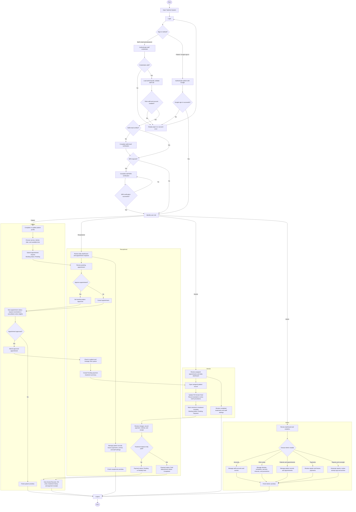

# Overall System Flowchart

This flowchart presents TopDent's implemented authentication, role-specific modules, and the shared patient appointment, treatment, dental chart, and payment lifecycle.

### Workflow notes

- Staff sign in with email and password. The system checks the staff document in `admins/{uid}`, validates the role and enabled status, then requires email verification and MFA when applicable. Patients authenticate with Google and maintain their profile before booking.
- Patient booking requests begin with `Pending`; receptionist approval changes the booking to `Approved`. Receptionist check-in records the check-in and creates pending entries in `paymentTreatmentSummaries`.
- Dentists open assigned patient records, save procedures to the Dental Chart, and mark an eligible checked-in treatment complete. That action moves the booking to `Pending Payment`; it does not represent a separate receptionist treatment-confirmation step.
- Receptionist payment recording updates payment records and their balances. An appointment is marked `Completed` after its treatment balances are fully settled; otherwise payment can remain `Pending` or `Partially Paid`.
- Patient Dental Records read the saved chart and treatment history, while Payment History reads existing treatment and braces receipts. These are separate views of the saved records.
